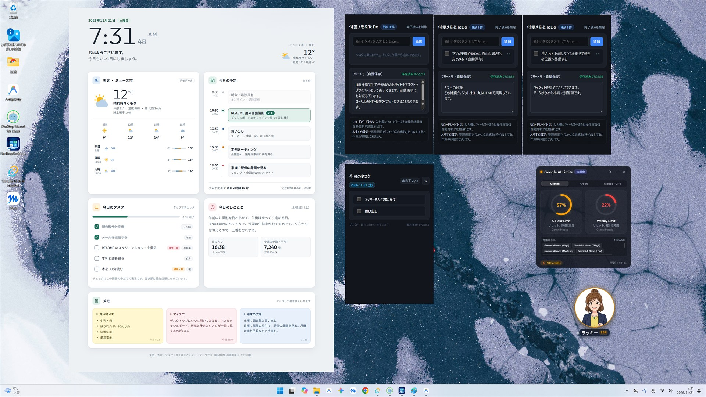
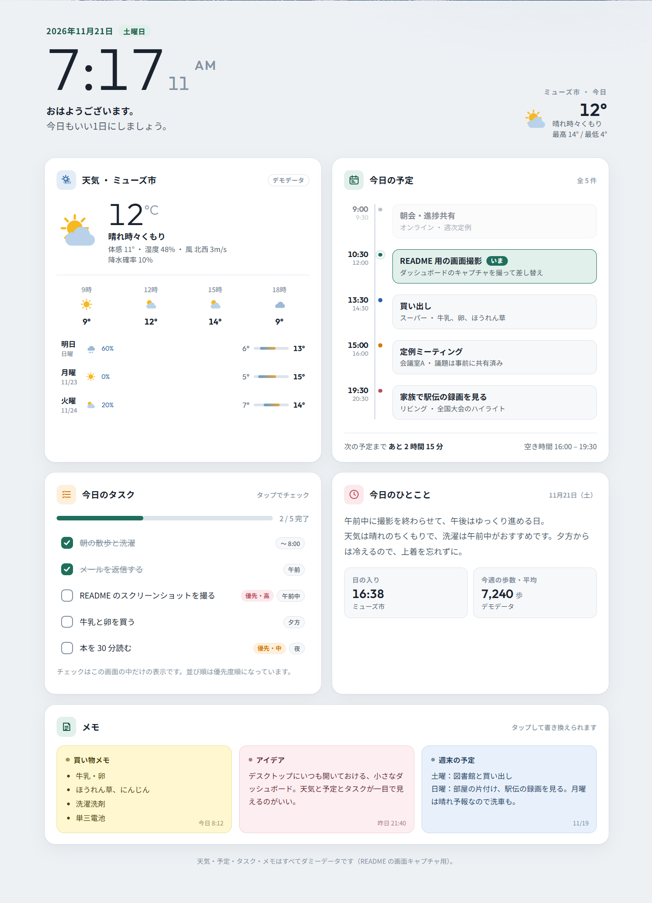
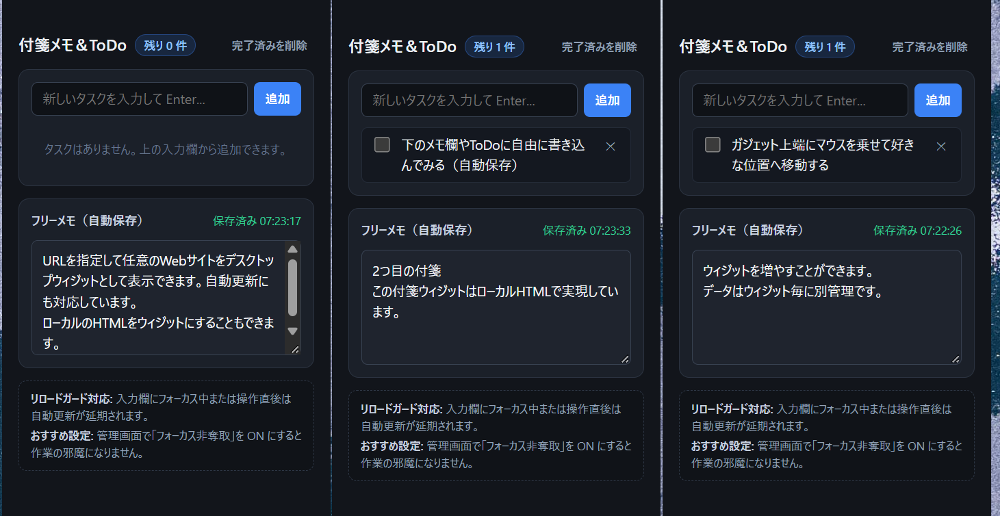
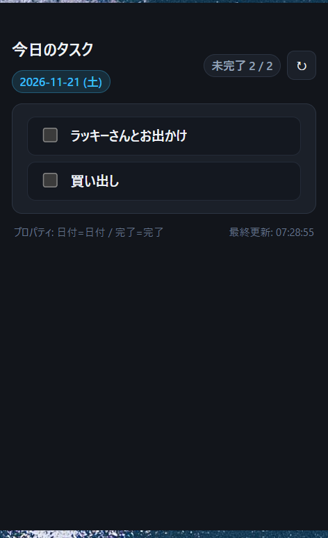
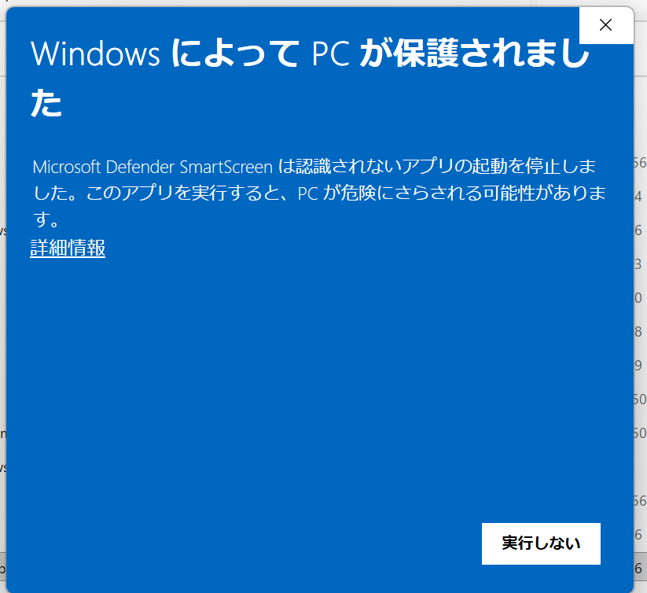

# DesktopDashboards

[](https://github.com/mowthow-works/DesktopDashboards/releases)
[](https://www.microsoft.com/windows)
[](LICENSE)

**DesktopDashboards** は、Web ページ・Muse のスペース・自作 HTML を Windows のデスクトップにそのまま「置ける」ガジェットアプリです。壁紙レイヤーに固定されるので、仕事の邪魔をせず、いつも目に入る場所に大事な情報だけを常駐させられます。



---

## できること

### Muse のスペースをデスクトップに
カスタム CSS でスペース部分だけを切り出して表示。毎朝のダッシュボードや作業用ボードを壁紙のように常駐できます。



### 付箋メモ＆ToDo を何枚でも
同梱の付箋はホバーバーや管理画面の「＋」ボタンから何枚でも増やせます。書いた内容は自動で分離保存され、アプリや PC を再起動してもそのまま残ります。



### Notion の今日のタスクを表示・チェック
今日やることだけをデスクトップに表示します。ウィジェット上で完了チェックを入れれば Notion 側にも即座に反映され、タスクをクリックするとそのまま Notion で開けます（要：自分の Notion トークン）。



### 任意の Web ページ／ローカル HTML をウィジェットに
URL を登録するだけ、あるいは手元の HTML ファイルを指定するだけでデスクトップ上に配置できます。AI に頼んで作った自作ツールやタイマー、チャートなどもそのまま常駐ウィジェットにできます。

---

## 特徴

- **最背面／壁紙レイヤーに固定**: 他ウィンドウの邪魔にならない最背面固定に加え、`Win + D`（デスクトップを表示）を押しても消えない壁紙レイヤー埋め込みにも対応
- **作業の邪魔をしない表示操作**: 誤移動を防ぐロック機能、透明度調整、クリック透過（背後のデスクトップを操作可能）、クリックしても IME や作業中アプリのフォーカスを奪わない設定を用意
- **入力中を待つスマート自動リロード**: 1〜60 分間隔でページを自動更新。テキスト入力中や操作直後は自動でリロードを延期して入力内容を守ります
- **カスタム CSS で好きな部分だけ表示**: ガジェットごとに CSS を設定し、サイドバーやヘッダーを隠して必要なコンテンツだけを画面いっぱいに表示できます
- **ローカル完結の安全な API 連携**: Notion などの API トークンは Windows 資格情報マネージャーへ暗号化保管し、開発者のサーバーを経由せずに手元の PC から直接通信します

---

## 📥 インストール

[Releases](https://github.com/mowthow-works/DesktopDashboards/releases) からインストーラまたはポータブル版 ZIP をダウンロードしてください。

- **インストーラ版（推奨）**: `DesktopDashboards_x64-setup.exe`
  - 管理者権限不要のユーザー別インストールで、スタートメニュー・デスクトップショートカット・同梱サンプル・アンインストーラが自動でセットアップされます。
- **ポータブル版**: `DesktopDashboards-windows-x64.zip`
  - 任意のフォルダに展開し、中の `DesktopDashboards.exe` をダブルクリックするだけで起動できます。

<details>
<summary>Windows SmartScreen 警告（「Windows によって PC が保護されました」）が出た場合</summary>

ダウンロードしたインストーラや実行ファイルの初回起動時に、青い警告画面が表示されることがあります。これは個人開発・オープンソースのアプリに対して Windows が「ダウンロード実績がまだ少ないアプリ」として機械的に表示する確認画面です。以下の手順でそのまま実行できます。

<div align="center">
  
</div>

1. 警告画面内の **「詳細情報」**（下線リンク）をクリックします。
2. 右下に表示される **「実行」** ボタンをクリックします。

> [!TIP]
> `.exe` ファイルを右クリック ➜ **「プロパティ」** ➜ 全般タブ下部の **「セキュリティ: 許可する」**（または「ブロックの解除」）にチェックを入れて「OK」を押すことでも解消できます。

</details>

---

## 使い方（3 ステップ）

初回起動時は体験用サンプルとして **「付箋メモ＆ToDo」** が 1 枚自動で表示されます。

1. **追加する**: タスクトレイのアイコンをダブルクリックして管理画面を開き、Web URL またはローカル HTML（「参照...」から同梱サンプルも選択可能）を登録します。
   <!-- 任意スクリーンショット:  -->
2. **位置や見た目を整える**: ウィジェットの上端にマウスを当てるとホバーバーが現れます。ドラッグして好きな場所・サイズに調整し、必要に応じて透明度やズーム・カスタム CSS を設定します。
   <!-- 任意スクリーンショット:  -->
3. **ロックして常駐させる**: ホバーバーの南京錠ボタン（または管理画面・トレイメニューのロック）をオンにするとバーと枠が消え、壁紙の一部としてスッキリ常駐します。

---

## 同梱サンプル

`samples/` フォルダに収録されており、管理画面の「ローカル HTML」➜「参照...」からすぐに試せます。

| サンプル名 | ファイル | できること |
| :--- | :--- | :--- |
| 付箋メモ＆ToDo | `samples/sticky-todo.html` | 書いたメモを自動保存。「＋」で何枚でも増やせて中身も個別に保持 |
| Notion 今日のタスク | `samples/notion-today.html` | 今日期限（＋期限切れ）の Notion タスク一覧表示・双方向チェック更新・複数 DB 対応 |
| ポモドーロ集中タイマー | `samples/pomodoro-timer.html` | 円形プログレスリング・チャイム通知（消音可）・本日の完了セット数記録 |
| 自作スターターテンプレート | `samples/starter-template.html` | 相対パス読み込み・ホバーバー余白・設定保存などを試せる自作向けひな形 |

---

## Notion 連携

管理画面の **「外部サービス接続（SaaS 連携）」** にご自身の Notion Integration トークン（`ntn_...`）を登録し、サンプルの **`samples/notion-today.html`** を追加するだけで「Notion 今日のタスク」を利用できます。  
API トークンは Windows 資格情報マネージャーに暗号化保管され、通信はお使いの PC と Notion API の間だけで直接行われます。

👉 詳しい設定手順（全 4 ステップ）は **[Notion 今日のタスク設定ガイド (docs/NOTION_GUIDE.md)](docs/NOTION_GUIDE.md)** をご覧ください。

---

## ウィジェットを自作する

手元の HTML / CSS / JS ファイルをそのままウィジェットとして動かせるほか、ローカルウィジェット専用の **`window.DD` ブリッジ** や manifest 設定を使うと、設定フォーム付きの外部サービス連携ウィジェットも作れます。

- HTML と同じフォルダ（またはサブフォルダ）の CSS / JS / 画像 / JSON を相対パスでそのまま読み込めます。
- 上端 28px にホバー操作バーが出るため、`body` に `padding-top: 32px` 程度の余白を空けると操作しやすくなります。
- `window.DD`（`DD.storage` / `DD.config` / `DD.connect` / `DD.openUrl`）や manifest（`"duplicable": true`、`config_schema`、`connections` 権限）、制限モードの仕様は **[仕様書・API リファレンス (docs/SPEC.md)](docs/SPEC.md)** にまとめています。まずは `samples/starter-template.html` を複製して試すのがおすすめです。

---

## 動作環境

- **対応 OS**: Windows 10 / 11 (x64)
- **ランタイム**: Microsoft Edge WebView2（Windows 11 には標準搭載、Windows 10 でも通常は導入済み）

---

## よくある質問（FAQ）

<details>
<summary><strong>Q. Win + D（デスクトップを表示）を押すとウィジェットが消えてしまいます</strong></summary>

配置モードが初期値の「最背面固定」になっている場合、Windows の仕様上 `Win + D` で最小化されます。管理画面の該当ウィジェットカードにある配置モードを **「壁紙レイヤー埋め込み」** に切り替えると、`Win + D` を押してもデスクトップに残り続けます。

</details>

<details>
<summary><strong>Q. ロックしたウィジェットを動かしたい・ロックを解除したい</strong></summary>

タスクトレイのアイコンを右クリックして **「すべてロック解除」** を選ぶか、トレイアイコンをダブルクリックして管理画面を開き、該当カードの **「ロック」** スイッチをオフにしてください（クリック透過をオンにした場合も同じ手順で解除できます）。

</details>

<details>
<summary><strong>Q. Notion のトークンや付箋メモのデータはどこに保存されますか？</strong></summary>

すべてお使いの PC のローカル環境にのみ保存され、開発者の外部サーバーへ送信されることはありません。ウィジェット設定やローカルストレージデータは `%APPDATA%\DesktopDashboards\` に、Notion などの API トークンは **Windows 資格情報マネージャー** に暗号化保管されます。

</details>

<details>
<summary><strong>Q. 新しいバージョンへアップデートすると設定やデータは消えますか？</strong></summary>

消えません。上書きインストールしても `%APPDATA%\DesktopDashboards\` 内の設定・データや Windows 資格情報マネージャーのトークンはそのまま引き継がれます。アップデート時に OS 側の自動起動登録がリセットされた場合でも、次回起動時に自動で復元します。

</details>

---

## 開発者向け

- **技術スタック**: Tauri v2 (Rust) + WebView2 + HTML/CSS/JS
- **前提環境**: Node.js v20 以上 / Rust 1.80 以上 (MSVC) / Visual Studio C++ Build Tools
- **コマンド**:

```powershell
npm install            # 依存パッケージ導入
npm run dev            # 開発モード起動
npm run test:rust      # Rust バックエンド単体テスト
npm run build:installer # NSIS インストーラ生成 (src-tauri/target/release/bundle/nsis/)
cargo build --release --manifest-path "src-tauri/Cargo.toml" # 単体 exe ビルド
```

- **CLI 引数・内部仕様**: `--manager` / `--add-url <URL> [--title <NAME>]` / `--silent` による外部連携、データモデル、`window.DD` ブリッジの多層防御仕様は **[docs/SPEC.md](docs/SPEC.md)** を参照してください。
- **検証用サンプル（開発者向け）**: `samples/notion-spike.html`（＋`samples/notion-spike.manifest.json`）は Notion API (`2025-09-03`) と `window.DD` ブリッジ（`DD.storage` / `DD.connect.request` / 権限積集合）の動作確認用サンプルです。

---

## 📜 ライセンス

[MIT License](LICENSE) © 2026 mowthow-works
